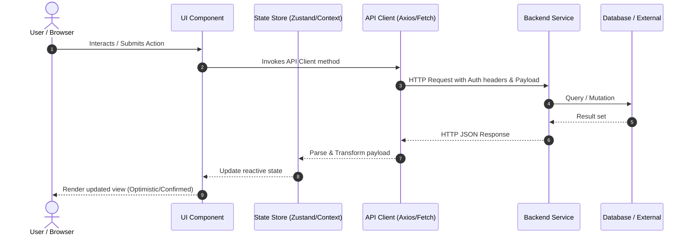

# Trishanti Frontend — Settings, API, and Flow Architecture

This document serves as the canonical architectural baseline for the Trishanti Frontend application in accordance with engineering and security documentation standards.

---

## 1. Settings & Configuration

### 1.1 Environment Configuration

The application uses standard environment variable configurations for development, staging, and production environments. Secrets must strictly remain server-side and never be exposed in client-facing bundles.

| Variable Name | Description | Default (Dev) | Scope |
| :--- | :--- | :--- | :--- |
| `VITE_API_BASE_URL` / `NEXT_PUBLIC_API_URL` | Base URL for the Trishanti Backend API | `http://localhost:8000/api/v1` | Public (Client) |
| `VITE_APP_ENV` / `NEXT_PUBLIC_APP_ENV` | Target environment identifier | `development` | Public (Client) |
| `VITE_APP_VERSION` | Application semver string | `1.0.0` | Public (Client) |

### 1.2 Defaults & Permissions

- **Default Protocol**: HTTPS enforced in production.
- **Client Storage Policy**: Sensitive access tokens stored in memory or secure HttpOnly cookies; non-sensitive UI settings (e.g., theme preference) stored in `localStorage`.
- **Permissions / RBAC**: Role-based access control (Admin, User, Guest) enforced via route guards on client navigation and validated independently on backend API requests.

---

## 2. API Specifications

### 2.1 Communication Contract

All frontend requests communicate with the Trishanti backend REST/GraphQL services using standard JSON payloads over HTTP/2 or HTTP/1.1 with TLS 1.3.

#### Core Headers
- `Content-Type: application/json`
- `Accept: application/json`
- `Authorization: Bearer <token>` (when authenticated)
- `X-Request-ID: <uuid>` (for distributed tracing)

### 2.2 Standard Response Structure

```json
{
  "success": true,
  "data": {},
  "message": "Operation completed successfully",
  "meta": {
    "timestamp": "2026-09-23T06:52:00Z",
    "requestId": "req-123e4567-e89b-12d3-a456-426614174000"
  }
}
```

### 2.3 Standard Error Structure

```json
{
  "success": false,
  "error": {
    "code": "VALIDATION_ERROR",
    "message": "Invalid input provided.",
    "details": []
  }
}
```

---

## 3. Architecture & Data Flow

### 3.1 End-to-End Data Flow



### 3.2 State Management & Synchronization

- **Component Layer**: UI components consume decoupled presentation hooks.
- **Network Layer**: Centralized API client handles token injection, exponential backoff retries on 5xx errors, and global 401 unauthenticated redirect handling.
- **Error Handling**: Graceful degradation with user-friendly error banners and notification toasts; no raw stack traces exposed to end-users.

---

## 4. Data Transformation & Validation

- **Client Validation**: Input schemas validated before dispatch (e.g., Zod) ensuring types and constraints match backend expectations.
- **Deserialization**: Date strings parsed to standard ISO format / date objects; numbers sanitized to avoid precision errors.
- **Null Safety**: All API response parsers handle optional/nullable fields gracefully to prevent runtime null pointer exceptions.

---

## 5. Cybersecurity & Secure Coding Controls

In accordance with OWASP Top 10 and Application Security requirements:

1. **Authentication & Session Management**:
   - Access tokens kept short-lived; refresh tokens stored via HttpOnly, Secure, SameSite=Strict cookies where feasible.
   - Immediate session termination upon 401/403 responses.
2. **Cross-Site Scripting (XSS) Prevention**:
   - Standard framework JSX/TSX escaping used. `dangerouslySetInnerHTML` or raw HTML sinks strictly disallowed without DOMPurify sanitization.
3. **Cross-Origin Resource Sharing (CORS)**:
   - Frontend configured to request only approved backend origins.
4. **Secret Management**:
   - Continuous scanning to prevent API secrets, private keys, or passwords in repository code.
   - All environment variables vetted to avoid leaking server-only environment variables.
5. **Content Security Policy (CSP)**:
   - Configured via hosting headers to restrict inline scripts, unsafe eval, and unauthorized external font/media resources.

---

## 6. Operations & Deployment

- **Version Control**: Git-flow with `main` representing production-ready code.
- **Build & Bundler**: Vite / Next.js production build with tree-shaking, minification, and chunk splitting.
- **Observability**: Client-side monitoring and error logging (e.g., Sentry) with telemetry scrubbing to strip PII and sensitive tokens before dispatch.
