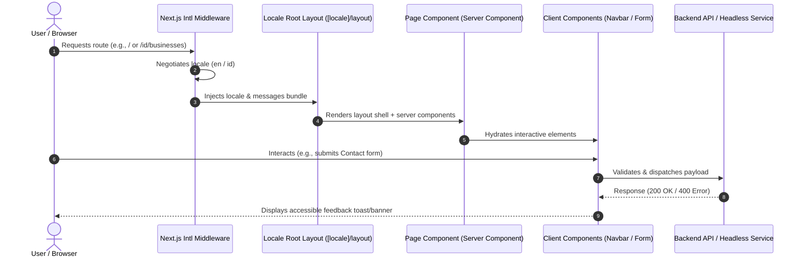

# Trishanti Frontend — Settings, API, and Flow Architecture

This document serves as the canonical architectural baseline for the PT. Trishanti Sinergi Indocorp Frontend application in accordance with engineering and security documentation standards.

---

## 1. Settings & Configuration

### 1.1 Environment Configuration

The application uses standard environment variable configurations for local development, staging, and production environments. Secrets must strictly remain server-side and never be exposed in client-facing bundles.

| Variable Name | Description | Default (Dev) | Scope |
| :--- | :--- | :--- | :--- |
| `NEXT_PUBLIC_APP_NAME` | Corporate application identifier | `Trishanti` | Public (Client) |
| `NEXT_PUBLIC_APP_ENV` | Target environment identifier | `development` | Public (Client) |
| `NEXT_PUBLIC_APP_URL` | Canonical origin URL for metadata & OpenGraph | `http://localhost:3000` | Public (Client) |
| `NEXT_PUBLIC_ENABLE_ANALYTICS` | Telemetry flag | `false` | Public (Client) |
| `NEXT_PUBLIC_ENABLE_I18N` | Internationalization routing flag | `true` | Public (Client) |

### 1.2 Defaults & Permissions

- **Default Protocol**: HTTPS enforced in production via HSTS (`max-age=63072000; includeSubDomains; preload`).
- **Locales**: Bilingual support via `next-intl`:
  - `en`: English (Default)
  - `id`: Bahasa Indonesia
- **Routing Strategy**: `localePrefix: "always"` with dedicated `src/app/page.tsx` root redirect to `/en`. This guarantees deterministic 1:1 route mapping without rewrite ambiguity or 404 dead-ends.
- **Frontend-First Self-Contained Architecture**:
  - The entire frontend operates with 100% hardcoded, local in-memory datasets (`src/lib/data.ts`) and mock endpoints (`src/app/api/`).
  - Zero live backend dependencies; all navigation, search modals, forms, and business pillars function independently.
- **Security Headers**:
  - `X-Frame-Options: DENY` (Anti-clickjacking)
  - `X-Content-Type-Options: nosniff` (MIME sniffing prevention)
  - `Referrer-Policy: strict-origin-when-cross-origin`
  - `Permissions-Policy: camera=(), microphone=(), geolocation=(), interest-cohort=()`
  - `Content-Security-Policy`: Restricts scripts, styles, fonts (`fonts.googleapis.com`), and images to trusted domains (`images.unsplash.com`).


---

## 2. API Specifications

### 2.1 Communication Contract

The frontend interacts with backend API endpoints for inquiries, newsletter submissions, and future headless CMS services.

#### Core Headers
- `Content-Type: application/json`
- `Accept: application/json`
- `X-Request-ID: <uuid>` (for distributed tracing)

### 2.2 Standard Response Structure

```json
{
  "success": true,
  "data": {},
  "message": "Operation completed successfully",
  "meta": {
    "timestamp": "2026-09-23T18:00:00Z",
    "requestId": "req-123e4567-e89b-12d3-a456-426614174000"
  }
}
```

### 2.3 Standard Error Structure

```json
{
  "success": false,
  "error": {
    "code": "VALIDATION_ERROR",
    "message": "Invalid input provided.",
    "details": []
  }
}
```

---

## 3. Architecture & Data Flow

### 3.1 End-to-End Data Flow



### 3.2 State Management & Synchronization

- **Component Layer**: Server Components by default for optimal First Contentful Paint (FCP) and zero bundle penalty.
- **Client Components**: Isolated exclusively to interactive state islands (`Navbar.tsx`, `LanguageSwitcher.tsx`, `ContactForm.tsx`, `Button.tsx`, `Input.tsx`).
- **Internationalization**: `next-intl` provides synchronous translations in Client components (`useTranslations`) and asynchronous messages in Server components (`getTranslations`).

---

## 4. Data Transformation & Validation

- **Client Validation**: Unconditional hook usage (`React.useId`), regex-checked emails, minimum length requirements, and visible labels above fields.
- **Exact Optional Property Types**: Full compliance with TypeScript `exactOptionalPropertyTypes: true`.
- **Null Safety**: Strict null checks enabled with zero implicit or explicit `any` types.

---

## 5. Cybersecurity & Secure Coding Controls

In accordance with OWASP Top 10, SonarQube, and Application Security requirements:

1. **Input Validation**: Strict input boundary validation before dispatch.
2. **Cross-Site Scripting (XSS) Prevention**: Standard React JSX escaping. No `dangerouslySetInnerHTML`.
3. **Content Security Policy (CSP)**: Enforced through `next.config.ts` headers.
4. **Secret Management**: No secrets committed or exposed to the client. `.env.local` strictly gitignored.
5. **Accessibility**: WCAG 2.2 AA compliant focus rings, skip-to-content anchor, semantic HTML landmarks (`header`, `nav`, `main`, `footer`).

---

## 6. Visual Design Architecture (Master Design System & Board Alignment)

The frontend strictly implements the approved visual boards and guidance text from the master design system:

### 6.1 Neutral Color System & Page Background (Image 1, 3, 4)
- **Core Rationale**: *"Using neutral 600 (#5E6663) as the main page background to create a refined, modern, and sophisticated experience."*
- **Neutral Scale Palette**:
  - `50`: `#F7F8F7` / `#F4F6F5` / `#F5F7F8` — Surface (Lightest)
  - `100`: `#EFF1F0` / `#ECEFEE` / `#ECEFF1` — Section background
  - `200`: `#DEE3E1` / `#DDE3E7` — Borders / Dividers
  - `300`: `#CFD6D3` / `#CBD3D9` — Subtle borders
  - `400`: `#B8BFBC` / `#A6ADAA` / `#B7C2C9` — Disabled / Muted
  - `500`: `#9AA3A0` / `#7C8581` / `#9CA7BD` — Metadata
  - `600`: `#5E6663` / `#7F8A93` — **Main page background** (`<-- Page background`)
  - `700`: `#414946` / `#5F6874` — Secondary text
  - `800`: `#292F2D` / `#3E464D` — Headings
  - `900`: `#171C1B` / `#1F2930` — Maximum contrast
- **Primary Colors**:
  - Cyan-Teal: `#00A6A6` (Brand identity, Progress, Connection)
  - Deep Midnight: `#071A22` (Authority, Trust, Long-term thinking)
  - Architectural White: `#FFFFFF` / `#F8FAFB` (Surface / Cards)
- **Secondary Colors**:
  - Ocean Blue: `#2F5F73` (Infrastructure, Technology, Global perspective)
  - Forest Green: `#406057` (Agriculture, Sustainability, Growth)
  - Earth Copper: `#A66A3F` (Industry, Resources, Material value)
  - Warm Sand: `#DBC8B5` (People, Lifestyle, Humanity)
- **Semantic UI Colors**:
  - Success: `#16A34A`
  - Warning: `#F59E0B`
  - Error: `#DC2626`
  - Info: `#2563EB`
- **Color DO's and DON'Ts**:
  - **DO**:
    - Use colors with purpose
    - Keep accents minimal
    - One contextual color per section
    - Maintain brand consistency
    - Let photography lead
  - **DON'T**:
    - Use multiple accent colors together
    - Make large colored backgrounds (other than neutral 600 or brand midnight)
    - Replace brand CTA color
    - Use bright / saturated tones
    - Use color for decoration only

### 6.2 Radius System & Component Specifications (Image 5 — Radius System)
- **Philosophy**: *"Defined corners. A more refined experience. A consistent radius system creates visual harmony across every touchpoint, from components to full-scale experiences. Design for a Greater Tomorrow."*
- **01 Radius Scale**:
  - `0px` None — Structural / Flush (Text button `0px`)
  - `4px` XS — Micro / Precise (Square image `4px`)
  - `8px` SM — Small components / Inputs (Inputs `8px`, Search `8px`, Tooltips `8px`, Compact cards `8px`)
  - `12px` MD — Standard UI / Cards Primary (Standard cards `12px`, Card images `12px`, Alert / Notification `12px`)
  - `16px` LG — Premium / Featured (Featured cards `16px`, Featured images `16px`, Glass panels `16px`, Modals / Dialogs `16px`)
  - `24px` XL — Editorial / Visual (Editorial cards `24px`, Editorial images `24px`)
  - `9999px` Full — Pills / Buttons / Avatars (Primary & Secondary buttons `9999px`, Tags / Badges `9999px`, Avatars `9999px`)
- **05 Image Radius Usage**:
  - Images adapt strictly to their container's radius:
    - Square Image: `4px`
    - Card Image: `12px`
    - Featured Image: `16px`
    - Editorial Image: `24px`
- **06 Radius DO's and DON'Ts**:
  - **DO**:
    - Use the defined radius scale consistently
    - Match image radius to its container
    - Use larger radius for emphasis (not everywhere)
    - Keep primary and secondary buttons consistent
    - Maintain a balance between structure and softness
  - **DON'T**:
    - Use random radius values (e.g. 7px, 13px, 18px)
    - Overuse large radius on all components
    - Mix too many radius styles on a single page
    - Use overly rounded corners for corporate content
    - Ignore context (e.g. text button with large radius)

### 6.3 Gradient System & Glass Transparency (Board B.2 / B.3)
- **Signature Gradient**: Cyan -> Teal (`#2288C7` -> `#00A6A6` -> `#087C8C`)
- **Midnight Atmospheric**: Deep Midnight (`#071A22` -> `#102B35` -> `#1B3E46`)
- **Contextual Gradients**: Pillar-specific tones (Green, Blue, Copper, Sand)
- **Glass & Transparency Options**:
  - Glass (Subtle Blur): `rgba(255, 255, 255, 0.6)`, `backdrop-filter: blur(12px)`. Navigation, overlays, cards.
  - Frosted: `rgba(255, 255, 255, 0.4)`, `backdrop-filter: blur(20px)`. Hero overlays, modals.
  - Tinted Glass: `rgba(7, 26, 34, 0.65)` / `rgba(7, 26, 34, 0.85)`, `backdrop-filter: blur(16px)`. Dark sections, floating navigation.
  - Solid Translucent: `rgba(255, 255, 255, 0.8)`. Clean fallback.
- **Gradient & Transparency DO's and DON'Ts**:
  - **DO**:
    - Use gradients subtly and intentionally
    - Combine gradients with photography
    - Keep UI clean and minimal
    - Use glass effects with restraint
  - **DON'T**:
    - Use bright or neon gradients
    - Overuse glassmorphism
    - Apply gradients to every element
    - Use gradients where solid colors work better

### 6.4 Image Placement Strategy — A.3.4 (Image 2)
- **Philosophy**: *"Images should explain, amplify, or emotionally deepen the story — not merely fill empty space."*
- **Four Core Pillars of Imagery**:
  - **Purposeful**: Every image has a clear role
  - **Consistent**: Aligned with the Trishanti visual world
  - **Balanced**: Visuals and content work together
  - **Meaningful**: Builds trust, emotion, and understanding
- **Image Placement DO's and DON'Ts**:
  - **DO**:
    - Use purposeful images that support the content
    - Maintain consistent style, color grading, and quality
    - Use a balanced mix of imagery and whitespace
    - Ensure text readability with proper contrast and copy space
  - **DON'T**:
    - Don't use irrelevant or generic stock photos
    - Don't overuse images — avoid visual clutter
    - Don't use imagery that misrepresents our operations
    - Don't sacrifice performance for unnecessary media
- **Key Takeaways**:
  - *"Great image placement doesn't just make a website look better. It makes the story clearer, the message stronger, and the experience more memorable."*
  - *"Design with restraint. Let the opportunities speak louder."*


### 6.1 Seven Page Architectures
1. **Homepage (Item 1)**:
   - Header: TRISHANTI bold tracking wordmark with `A BRIGHTER TOMORROW, TOGETHER`, nav links, Search icon, and Cyan pill CTA `Contact Us`.
   - Hero: Metropolis suspension bridge at twilight, `BUILDING OPPORTUNITIES FOR GENERATIONS.`, Cyan pill `Our Businesses →`, glass pill `Watch Video ▷`, right editorial text *People · Industries · A Brighter · Tomorrow.*
   - Pillars: `OUR BUSINESS PILLARS` / `Diverse Industries. Greater Possibilities.`, 6 cards with 12px radius, SVGs, and Cyan arrow circle.
   - Purpose: Split section with winding river through pine forest (`purpose-river-hd.jpg`), *Building Businesses for a Better Tomorrow.*, Cyan pill `Our Commitment →`, 4 key impact metrics (6 pillars, 10+ years, 1,000+ people, A Brighter Tomorrow).
   - News: `Stories That Move Us Forward.`, 3 cards with tag pills (`Corporate`, `People`, `Sustainability`) and Cyan arrows.
   - Footer: Deep Midnight `#071A22`, wordmark, inline navigation, social media icons, copyright.

2. **About / Corporate Page (Item 2)**:
   - Hero: Clean white background, bold serif `People Build Progress.`, subtext, and high-res photography of two engineers in hard hats & yellow vests looking out over sunrise horizon (`/images/about/hero-engineers-hd.jpg`).
   - Our Journey: Wide panoramic coastal port/skyline banner (`/images/about/our-journey-panorama.jpg`) with horizontal timeline markers (`2010`, `2015`, `2020`, `2025`).
   - Leadership: `Leadership` with `View Leadership →`, 4 clean executive portrait cards in tailored suits against neutral studio backgrounds (`/images/about/leader-1.jpg` to `leader-4.jpg`).
   - Our Culture: Split section — team collaboration in glass boardroom (`/images/about/our-culture.jpg`) on left, quote and `Learn More →` on right.

3. **Business Pillar Page (Item 3)**:
   - Hero: `/ INFRASTRUCTURE` / `Building Better Connections.`, curved highway suspension bridge background (`/images/businesses/infrastructure-hero.jpg`).
   - Our Focus Areas: 3 cards with photos: `Transportation →`, `Urban Development →`, `Utilities →`.
   - Metrics Banner: Deep Midnight `#071A22` 3-column stats: `120+ Projects Supported` | `15 Strategic Partnerships` | `10M+ People Impacted`.

4. **Individual Business Page (Item 4)**:
   - Hero: `/ RENEWABLE ENERGY` / `Powering a Cleaner Tomorrow.`, rolling hills with wind turbines background (`/images/businesses/renewable-hero.jpg`).
   - Our Approach: Split layout with solar panel engineering image (`/images/businesses/approach-solar.jpg`) and strategic philosophy text.
   - Related Businesses: 2 cards (`Energy Solutions`, `Green Infrastructure`) with imagery and cyan arrows.

5. **Portfolio Section (Item 5)**:
   - Header: `Our Portfolio` / `Diverse businesses. Greater possibilities.`
   - Filter Tabs: `All`, `Consumer`, `Food & Beverage`, `Technology`, `Services`.
   - 4 Asset Cards: `SteakMary` (Food & Beverage), `NexaTech` (Technology), `BumiLestari` (Agriculture), `UrbanLiving` (Real Estate).

6. **News / Insights Page (Item 6)**:
   - Header: `Insights for a Brighter Tomorrow.`
   - Filter Tabs: `All`, `Corporate`, `Industry`, `Sustainability`, `People`.
   - Editorial News Cards: Featured article (`The Role of Renewable Energy in a More Resilient Future`) + list cards (`Investing in People and Communities`, `Sustainable Growth Through Innovation`).

7. **Sustainability Page (Item 7)**:
   - Hero: Panoramic emerald river and pine forest view (`/images/sustainability/sustainability-hero.jpg`), `A More Sustainable Tomorrow.`
   - 3 Pillar Cards: `Environment →` (rainforest canopy), `Social →` (youth & community), `Governance →` (modern architectural glass headquarters).

### 6.2 Navigation Architecture & Business Mega Menu (Board 3 Alignment)
1. **Desktop Header — Hero State**:
   - Transparent navigation over hero section with brand logo `TRISHANTI`, slogan "Greater Possibilities for a Better Tomorrow", nav links (`About`, `Business`, `Portfolio`, `Insights`, `Contact`), Search trigger, language toggle (`ID / EN`), and Cyan Contact CTA.
2. **Desktop Header — Transition & Scrolled State**:
   - Floating glass navigation capsule (`max-w-5xl rounded-full bg-[#071A22]/90 backdrop-blur-xl border border-white/15 px-6 py-2 shadow-2xl`).
3. **Business Mega Menu**:
   - Interactive 3-column panel:
     - Left (Col 1): `Our Business Ecosystem`, overview text, and `View All Businesses →`.
     - Center (Col 2): 6 pillars list (`Resources & Industrial`, `Infrastructure & Property`, `Agriculture & Food`, `Technology & Digital`, `Consumer & Lifestyle`, `Future Ventures`) with interactive hover states and icons.
     - Right (Col 3): Interactive preview card updating dynamically with pillar photography, category badge, headline, subsectors pills, and `Explore Pillar →`.
4. **About Dropdown**:
   - Floating glass dropdown with subpage links: `About Trishanti`, `Our Purpose`, `Vision & Direction`, `Leadership`.
5. **Active Link State**:
   - Glowing cyan underline indicator (`#00A6A6`).

### 6.3 Mobile Navigation UX (Board 0 Alignment — 8 States)
1. **State 1 — Header Hero State**: Transparent navigation over hero section.
2. **State 2 — Header Scrolled State**: Frosted glass navigation after scrolling.
3. **State 3 — Open Navigation**: Full-screen overlay with Earth horizon bottom graphic and "Greater Possibilities for a Better Tomorrow".
4. **State 4 — About Menu (Expanded)**: Accordion subpages (`About Trishanti`, `Our Purpose`, `Vision & Direction`, `Leadership`) with `—` / `+` toggle.
5. **State 5 — Business Menu (Expanded)**: Accordion listing the 6 pillars + `All Businesses >`.
6. **State 6 — Pillar (Expanded)**: Business fields card under selected pillar with photo banner, headline, subsectors list, and `Explore Pillar →`.
7. **State 7 — Contact CTA**: Bottom card with "Let's Build What's Next.", `Contact Us →` cyan pill button, social media links, `ID / EN` toggle, and copyright.
8. **State 8 — Close Animation**: Smooth fade/slide transition.

### 6.4 Feedback, Loading & System States (Board A.5.15 Alignment)
1. **Item 01 — Loading States**: Cyan spinning rings, skeleton loaders, and inline spinners.
2. **Item 02 — Button States**: Default, Hover (cyan glow), Loading ("Sending..."), Success ("✓ Sent!" with `#16A34A`), and Disabled.
3. **Item 05 — Input Validation States**:
   - Default: Neutral border.
   - Focused: Glowing cyan ring (`#00A6A6`).
   - Success: Green border (`#16A34A`), green checkmark icon inside input, and green helper text ("Looks good!").
   - Error: Red border (`#DC2626`), red exclamation circle icon inside input, and red error message ("Please enter a valid email address.", etc.).
4. **Item 07 — No Search Results**: Search modal empty state with search icon, "No results for '...'", diagnostic tips, and `Explore Our Businesses →`.
5. **Items 10 & 11 — Success Screen**: "Thank you!", "Your message has been sent successfully. We appreciate your interest in Trishanti. Our team will be in touch with you soon.", with `Return to Home →`.
6. **Item 12 — 404 Error Page**: Large serif 404, architectural city skyline background, "This path leads somewhere we haven't built yet. Let's help you find your way back.", and `Return Home →`.
7. **Item 13 — 500 Error Page**: Large serif 500, architectural atmosphere background, "Something went wrong on our side. Our team has been notified. Please try again later.", and `Return Home →` + `Try Again`.

### 6.5 Data Visualization System (Board 01 Alignment)
- **Core Principle**: *"Clear data. Deeper insight. Greater possibilities. Turn data into a brighter tomorrow."*
- **Guiding Rules**:
  - Keep it simple and intentional.
  - Use brand colours consistently.
  - Prioritize clarity over decoration.
  - Use subtle gridlines and clear labels.
  - Provide meaningful narrative context.
  - Ensure accessibility and contrast.
  - Never use 3D or decorative charts.
  - Never clutter with unnecessary data.
  - Never make it feel like an overwhelming SaaS dashboard.
- **Two Environments**:
  1. **Light Mode**: Glass surface + subtle grid (`bg-white/80 backdrop-blur-xl border border-[#DEE3E1] text-[#171C1B]`).
  2. **Dark Mode**: Gradient surface + subtle grid (`bg-gradient-to-br from-[#071A22] via-[#0E2833] to-[#071A22] border border-white/10 text-white`).
- **Implemented Chart Types (`src/components/ui/DataCharts.tsx`)**:
  - **Revenue Growth Chart**: Smooth cubic bezier curve, glowing cyan stroke (`#00A6A6`), gradient area fill, milestone callout ($2.4B, +18.6% vs previous year), subtle dashed gridlines, and interactive point hover tooltip.
  - **Business Contribution Donut Chart**: $2.4B total revenue in center, proportional segments for 6 pillars (Infrastructure 32%, Industrial Trading 24%, Agriculture & Food 18%, Technology & Digital 14%, Consumer & Lifestyle 8%, Experiences & Ventures 4%), interactive hover slice expansion.
  - **Sustainability Progress Widget**: Key ESG metrics with clean teal progress bars and iconography (42% Carbon intensity reduction [Leaf], 78% Community programs [Users], 65% Water efficiency [Droplets], 90% Responsible sourcing [Sprout]) with year selector.
  - **Regional Growth Widget**: Geographic breakdown (Asia Pacific 42%, Indonesia 28%, Middle East 14%, Europe 10%, Americas 6%).
- **Color Tokens for Data**:
  - Primary: Cyan Teal `#00A6A6` / `#06B6D4`
  - Secondary: Ocean Blue `#3B82F6`
  - Success: Green `#22C55E`
  - Warning: Amber `#F59E0B`
  - Neutral: Slate `#64748B`

### 6.6 A.2.4 Accent Rules & Hierarchy
- **Golden Rule**: *"Color should communicate importance, context, or meaning. Never decoration alone."*
- **Accent Hierarchy**:
  1. **Primary Accent (Cyan-Teal `#00A6A6`)**: Brand identity, primary CTAs, action, and active state indicators.
  2. **Contextual Accents**: Business storytelling & atmospheric accents:
     - Ocean Blue `#2F5F73`
     - Forest Green `#486B57`
     - Earth Copper `#A66A3F`
     - Warm Sand `#D8C8B5`
  3. **Semantic Colors**: Status and user feedback:
     - Success: `#168C5A`
     - Warning: `#D97706`
     - Error: `#C62828`
     - Info: `#2563EB`
- **Accent Usage Ratio**: Strictly enforce **90–95% Neutral / Midnight / Photography** and **5–10% Accent Colors**.
- **CTA Strategy**:
  - One primary CTA per context.
  - **Primary CTA**: Filled Cyan-Teal `#00A6A6`, white text, `rounded-full` (9999px).
  - **Secondary CTA**: Translucent glass pill (`bg-[#414946]/70 border border-white/20`), `rounded-full` (9999px).
  - **Tertiary CTA**: Text link with arrow, `rounded-none` (0px).
- **DO & DON'T**:
  - **DO**: Use colors with purpose, keep accents minimal, use one contextual color per section, let photography lead.
  - **DON'T**: Use multiple accent colors together, make large colored background blocks, replace brand CTA color, use bright/saturated neon tones.

### 6.7 Shadow & Elevation System
- **Core Principle**: *"Elevation should be felt before it is seen."*
- **Light Mode Elevation (Warm Neutral Shadows)**:
  - Elevation 0: Integrated with the surface (no shadow).
  - Elevation 1 (Standard Cards): `0 4px 16px rgba(23, 28, 27, 0.06)`.
  - Elevation 2 (Hover / Interactive): `0 8px 24px rgba(23, 28, 27, 0.08)`.
  - Elevation 3 (Overlays / Modals): `0 16px 48px rgba(23, 28, 27, 0.12)`.
- **Dark Mode Elevation (Tonal Gradients & Ambient Glow)**:
  - Elevation 0: Integrated with background (no shadow).
  - Elevation 1: Standard surface with tonal gradient lift (`#071A22` to `#0E2833`).
  - Elevation 2: Interactive surface with stronger gradient + cyan edge highlight (`border-[#00A6A6]/40`).
  - Elevation 3: Overlay / modal surface with ambient cyan glow (`shadow-[0_0_30px_rgba(0,166,166,0.2)]`).

### 6.8 Motion & Interaction System
- **Motion Tokens**:
  - `fast`: `150ms` (hover states, toggles, badges)
  - `normal`: `300ms` (dropdowns, cards, accordions, modals)
  - `slow`: `500ms` (page transitions, image zoom reveals)
- **Easings**:
  - Standard: `cubic-bezier(0.4, 0.0, 0.2, 1)`
  - Emphasized: `cubic-bezier(0.2, 0.0, 0, 1)`
  - Entrance: `cubic-bezier(0, 0, 0.2, 1)`
  - Exit: `cubic-bezier(0.4, 0, 1, 1)`
- **Micro-Interactions**:
  - Arrow icon shifts +4px on hover.
  - Buttons scale to `0.98` on press.
  - Image zooms to `scale-105` inside cards on hover.

### 6.9 A.5.22 Search, Filter & Discovery Patterns
- **01 Search Input States**: Default, Focused (cyan ring), Typing (clear 'x' button), Dark Mode (`src/components/layout/SearchModal.tsx`).
- **02 Search Suggestions**: Popular searches chips (`Sustainability`, `Annual Reports`, `Our Businesses`, `Careers`, `Corporate Governance`) and Recent searches with "Clear all".
- **03 Search Results & Filter Tabs**: Result counts with filter chips (`All`, `News`, `Our Businesses`, `Reports`).
- **04 Empty & Loading States**:
  - Searching state with animated cyan spinner.
  - "No results found" state with diagnostic bullet tips ("Check your spelling", "Use a more general search term", "Explore related business topics") and `Explore All Content →` CTA button.
- **05 Quick Filter Chips**: Integrated category filters with dynamic item counts.
- **07 Content List / Grid View Switcher**: Interactive list/grid toggle button (`src/components/news/NewsDiscovery.tsx`).
- **08 Numbered Pagination & Load More**: Pagination pills (`< 1 2 3 >`) and `Load More Stories ↻` button.
- **11 Document Search & Filter Pattern**: Category pills (`All Documents`, `Annual Reports`, `Sustainability`, `Governance`, `Policies`), Year dropdown, PDF icon, file size badge (`PDF 12.4 MB`), publication date, and download button icon (`src/components/ui/DocumentList.tsx`).

### 6.10 Breakpoint System & Fluid Scaling (Image 1 Alignment)
- **Key Principle**: *"Break when the layout needs to break — not because a particular device exists."*
- **Grid & Container Specifications**:
  - `XS` (< 480px): Columns 4, Container Fluid, Gutter 16px, Horizontal Padding 20px (`px-5`). Single column, optimized for touch.
  - `SM` (480–767px): Columns 4, Container Fluid, Gutter 16px, Horizontal Padding 20px (`px-5`). Flexible card layout.
  - `MD` (768–1023px): Columns 8, Container Fluid, Gutter 20px, Horizontal Padding 24px (`px-6`). Two-column layout, hybrid navigation.
  - `LG` (1024–1279px): Columns 12, Container 1280px (`max-w-[1280px]`), Gutter 24px, Horizontal Padding 32px (`px-8`). Full desktop navigation.
  - `XL` (1280–1535px): Columns 12, Container 1280px (`max-w-[1280px]`), Gutter 24px, Horizontal Padding 32px (`px-8`). Multi-column layout.
  - `2XL` (≥ 1536px): Columns 12, Container 1440px (`max-w-[1440px]`), Gutter 24px, Horizontal Padding 48px (`px-12`). Enhanced visual compositions.
- **Fluid Typography Tokens using `clamp()`**:
  - Hero Heading: `clamp(2rem, 6vw, 4.5rem)` (`clamp(32px, 6vw, 72px)`)
  - Section Heading: `clamp(1.5rem, 4vw, 3rem)` (`clamp(24px, 4vw, 48px)`)
  - Body Text: `clamp(1rem, 2vw, 1.25rem)` (`clamp(16px, 2vw, 20px)`)
  - Caption: `clamp(0.75rem, 1.5vw, 0.875rem)` (`clamp(12px, 1.5vw, 14px)`)
- **Spacing Scale Across Breakpoints**:
  - Mobile: `56px` | Tablet: `72px` | Desktop: `96px` | Large / Ultra-wide: `160px`.

### 6.11 Illustration & Graphic Elements (Image 2 Alignment)
- **Visual Language**: *"Structure. Movement. Possibility. A unified visual language to tell bigger stories, connect ideas, and bring our purpose to life."*
- **Core Primitives (`src/components/ui/GraphicElements.tsx`)**:
  - **Architectural Grid**: Subtle grid background pattern with corner structural lines (`.ArchitecturalGrid`).
  - **Directional Paths**: Curved bezier curves with cyan arrowheads indicating forward trajectory (`.DirectionalPath`).
  - **Diagrammatic Nodes**: Clean interconnected circles with brand lines.
- **Ecosystem Visualization Diagram (`<EcosystemDiagram />`)**:
  - Center: TRISHANTI brand node with tagline "A BRIGHTER TOMORROW, TOGETHER".
  - Outer Nodes (Trigonometric SVG layout): `People` (Empowered communities), `Innovation` (Future-ready solutions), `Opportunities` (A more inclusive tomorrow), `Environment` (A healthier planet), `Industries` (Sustainable growth).
- **DO & DON'T**:
  - **DO**: Use elements with purpose, keep it minimal and refined, maintain consistent stroke, use cyan accent strategically.
  - **DON'T**: Use generic illustrations or cartoon characters, make it overly decorative, use excessive glowing effects, clutter composition with too many elements.

### 6.12 Data, Statistics & Information Display (Image 3 - A.5.21 Alignment)
- **Core Principle**: *"Real numbers. Real progress. A clearer tomorrow. Turning complex information into clear, meaningful stories."*
- **Components (`src/components/ui/InformationDisplay.tsx`)**:
  - **01 Hero Statistics**: 250,000+ Trees, 48 Community Programs, 12 Regional Initiatives, 1,000+ People.
  - **03 Renewable Energy Capacity Bar Chart**: 2021–2025 growth (200 MW to 720 MW) with interactive tabs and "+28% growth since 2021" callout.
  - **04 Comparison Block**: Today (Building Foundations) vs Tomorrow (Greater Possibilities) with pull quote (*"From local beginnings to a broader impact..."*).
  - **05 Radial Progress Indicators**: 75% Renewable Energy Target, 60% Community Engagement, 90% Sustainable Operations with SVG circular stroke tracks.
  - **06 Timeline / Milestones**: Chronological milestone markers (2014 Founded, 2017 Expansion, 2020 Framework, 2023 Regional Growth, 2025 A Stronger Tomorrow).
  - **08 Multi-Year Financial Data Table**: Tabs for Business Performance, Sustainability Impact, People & Community; audited figures for Revenue, EBITDA, and Total Assets.

### 6.13 Content & Editorial System (Image 4 - A.5.20 Alignment)
- **Editorial Voice**: *"Clear. Confident. Human. A consistent voice for a greater tomorrow."*
- **Content Hierarchy**:
  - 01 Context: Eyebrow / Category / Label (e.g. `SUSTAINABILITY`)
  - 02 Primary Message: Headline (Playfair Display)
  - 03 Explanation: Lead Intro Paragraph
  - 04 Detail: Body / Sections / Pull quote / Captioned image / Statistic block
  - 05 Action: Standardized CTA
- **Standardized CTA Language**:
  - General: `Learn More →`
  - Business: `Explore Our Businesses →`
  - Sustainability: `Discover Our Commitment →`
  - News: `Read the Full Story →`
  - Careers: `Build Your Future With Us →`
  - Contact: `Start a Conversation →`
- **Article Page Layout (`src/app/[locale]/news/[slug]/page.tsx`)**:
  - Author byline with role and publication date.
  - Hero image with descriptive italic caption.
  - Numbered section markers (`01 The Bigger Picture`, `02 Our Approach`).
  - Pull quote block with brand border and cite attribution.
  - Inline verified impact statistics block.
  - Related stories cards with hover effect and cyan arrow.

### 6.14 Accessibility & Inclusive Experience (Image 5 - A.5.18 Alignment)
- **Core Principle**: *"Beautiful by default. Accessible by design. Everyone should be able to experience a brighter tomorrow."*
- **Contrast & Readability**: Pass WCAG 2.2 AA contrast standards (7.2:1 light mode, 8.1:1 dark mode).
- **Color Independence**: Status, validation, and feedback are never communicated by color alone (always paired with clear icons and explicit text).
- **Focus Indicators**: Visible cyan focus rings (`outline: 2px solid #00A6A6; outline-offset: 3px;`).
- **Keyboard Navigation**: Full keyboard operability via Tab, Shift+Tab, Enter, Space, Esc.
- **Skip Navigation**: `<a href="#main-content" className="skip-to-content">` present in root layout for screen reader and keyboard accessibility.
- **Touch Targets**: Minimum 44 x 44px on all interactive elements (buttons, inputs, pills, nav toggles).
- **Motion Reduction**: `@media (prefers-reduced-motion: reduce)` disables non-essential animations.
- **Semantic Structure**: Proper landmarks (`<header>`, `<nav aria-label="...">`, `<main id="main-content">`, `<section>`, `<article>`, `<footer>`).

### 6.15 Modal & Overlay System (Image 1 Alignment)
- **Core Principle**: *"Bring the right information forward, without losing context. Focused interactions. Seamless experiences. A more human web."*
- **01 Modal / Dialog (Light Mode)**: Frosted glass surface, subtle blur, clear hierarchy, focused on content (`src/components/ui/Modal.tsx` - `<ContactModal />`).
- **02 Modal / Dialog (Dark Mode)**: Tonal dark surface (`#071A22`), subtle gradient, accent focus, minimal and clean (`<NewsletterModal />`).
- **03 & 04 Side Drawers (Desktop & Mobile)**: Frosted surface, smooth slide, structured navigation, language selection, and teaser card.
- **05 Dropdown (Light & Dark)**: Selection menus with glass effect (light) and tonal surface (dark), checkmark on active item.
- **06 Popover**: Contextual information and quick actions (`src/components/ui/Popover.tsx` - `<ReportPopover />` with View Report, Download PDF, Share Link).
- **07 Tooltip**: Helpful hints with dark balloon and cyan info icon (`src/components/ui/Tooltip.tsx` - `<Tooltip />`).
- **08 Toast / Notification**: 4 semantic feedback alerts (`src/components/ui/Toast.tsx`):
  - Success (Green check): *"Message sent successfully! We'll be in touch soon."*
  - Info (Blue info): *"Your download is starting. This may take a few seconds."*
  - Warning (Orange alert): *"Please check your input. The email address seems invalid."*
  - Error (Red alert): *"Something went wrong. Please try again later."*
  - Auto-dismiss after 4000ms and manual close button.
- **11 Layering System (Exact Z-Index Hierarchy)**:
  - `z-critical`: 80
  - `z-toast`: 70
  - `z-modal`: 60
  - `z-drawer`: 50
  - `z-tooltip`: 40
  - `z-popover`: 30
  - `z-dropdown`: 20
  - `z-navigation`: 10
  - `z-base`: 0
- **12 Backdrop Specifications**:
  - Light Mode: `rgba(20, 30, 28, 0.18)` + blur (`.backdrop-overlay-light`)
  - Dark Mode: `rgba(4, 14, 18, 0.65)` + subtle blur (`.backdrop-overlay-dark`)
- **13 Interaction Behavior**:
  - Escape closes: Modal, Drawer, Dropdown, Popover, Tooltip.
  - Click outside: Modal, Drawer, Dropdown, Popover.
  - Focus trap: Modal, Drawer.
  - Scroll lock: Modal, Drawer.

### 6.16 Cards & Content Components (Image 2 - A.5.16 Alignment)
- **Core Principle**: *"Flexible building blocks. Consistent structure. Meaningful content."*
- **Components (`src/components/composite/ContentCards.tsx`)**:
  - **01 & 07 Content Card (Light & Dark)**: Standard card for articles, insights, and content with tag, date, title, excerpt, and "Read More →".
  - **03 & 09 Feature Card**: Showcase key initiatives or business units with full photo background, dark gradient, pill badge, title, description, and circular cyan arrow CTA button.
  - **05 & 11 Card with Tags**: Multi-tag categorization (`Sustainability`, `Innovation`), publication date, title, excerpt, and hover glow.
  - **06 & 12 Card List / Compact**: Horizontal list item with thumbnail, date, title, and right arrow for secondary content.
  - **13 Accordion**: Clean collapsible with animated indicator for structured corporate questions:
    - *What We Do*: Core multi-sector operations and value creation.
    - *Our Approach*: Disciplined capital allocation and agile execution.
    - *Our Impact*: Employment, supply chains, and clean energy transition.
    - *Partner With Us*: Global institutional co-investment opportunities.
  - **14 Tabs**: Content switching tabs (`Overview`, `Impact`, `People`, `News`).
  - **16 Breadcrumb**: Structured hierarchy trail (`Home > Our Businesses > Infrastructure`).
  - **17 Divider**: Decorated text divider (`— A Brighter Tomorrow —`) and minimal divider lines.
  - **18 List Group**: Styled link list for official reports (Annual Report, Sustainability Report, Investor Presentation, Corporate Governance).

### 6.17 Form & Input System (Image 4 - A.5.13 Alignment)
- **Core Principle**: *"Clear inputs. Confident interactions. A more human experience."*
- **Components (`src/components/ui/Input.tsx`)**:
  - **01 & 02 Input States (Light & Dark)**:
    - *Default*: Clean, minimal, neutral border.
    - *Hover*: Subtle border highlight.
    - *Focused*: Cyan outline/glow (`#00A6A6`) with focus ring.
    - *Filled*: Valid value present with green checkmark icon inside input on the right.
    - *Disabled*: Muted gray background, non-interactive.
  - **03 Validation States**:
    - *Success*: Green check icon + *"Looks good!"* confirmation text.
    - *Error*: Red alert icon + red border + explicit guidance text.
    - *Helper*: Explanatory helper text beneath input.
  - **06 Checkbox, Radio Button & Toggle Switch**:
    - *Checkbox*: Unchecked, checked (cyan with white check), indeterminate (cyan with minus).
    - *Radio Button*: Unselected, selected (cyan center dot).
    - *Toggle Switch*: Off (gray pill), on (cyan pill with smooth toggle).
  - **07 Textarea**: Integrated character counter (`0/500`) at bottom right.
  - **08 File Upload**: Drag-and-drop dropzone supporting PDF, DOC, DOCX up to 10MB.
  - **11 Input with Icons**: Leading icon slots for User, Mail, Subject, Search, Calendar, Phone.

### 6.18 Iconography System (Image 1 Alignment)
- **Core Principle**: *"Icons communicate faster, guide actions, and bring clarity across every experience. Simple. Meaningful. Consistent."*
- **Components (`src/components/ui/IconSystem.tsx`)**:
  - **01 Icon Style**: Outline (Primary) exclusively. Filled and illustrative styles avoided.
  - **02 Stroke Weights**:
    - `1.5px`: Editorial / Large (24px and above).
    - `2px`: UI / Small (12–20px).
  - **03 Size Scale**:
    - `12px` (XS): Metadata
    - `16px` (SM): Inline
    - `20px` (MD): Navigation
    - `24px` (LG): Cards
    - `32px` (XL): Sections
    - `48px` (2XL): Hero / Graphic
  - **04 Interaction States**: Default (Neutral), Hover (Cyan accent), Active (Filled / Accent), Disabled (Muted).
  - **06 Curated Business Pillar Icons**:
    - *Infrastructure*: Foundation for progress (Ascending structure)
    - *Industrial Trading*: Connecting opportunities (Trade & processing)
    - *Agriculture & Food*: Nourishing communities (Botanical leaf)
    - *Technology & Digital*: Innovating tomorrow (Connected node network)
    - *Consumer & Lifestyle*: Enhancing everyday life (Community / people)
    - *Experiences & Ventures*: Exploring new horizons (Twin peaks / compass)
  - **07 Icon Containers**: Light Mode (glass container) and Dark Mode (gradient container).
  - **08 & 09 User Dropdown Menu**: Elevation 1 & 2 menu with Profile, Settings, Notifications (with unread badge "3"), and Log out.
  - **11 Social Icons**: Official brand vector icons for LinkedIn, Instagram, YouTube, and X.

### 6.19 Business Discovery UX & Navigation (Image 5 & Image 2 Alignment)
- **Navigation Architecture (`src/components/layout/Navbar.tsx`)**:
  - **Desktop Header**: Transparent hero state transitioning to frosted glass scrolled state (`bg-[#071A22]/90 backdrop-blur-xl`).
  - **Hover & Active Indicators**: Cyan underline bar with rounded ends.
  - **Interactive Business Mega Menu**:
    - Ecosystem headline and "View All Businesses →" link.
    - 6-pillar selector list with icons.
    - Active pillar preview card with `01 / 06` counter and circular `<` `>` pagination controls.
    - User profile dropdown trigger in desktop right navigation.
  - **Mobile Menu Drawer**:
    - Nested accordion navigation with `< Business` back flow.
    - All Businesses directory link.
    - Contact CTA card and social icon links.
- **5-Level Business Discovery Flow**:
  - *Level 01*: Homepage Ecosystem Preview with cinematic cards (`src/components/home/PillarsSection.tsx`).
  - *Level 02*: Business Index with 7 category filter pills (`src/app/[locale]/businesses/page.tsx`).
  - *Level 03*: Pillar Deep Dive (`src/app/[locale]/businesses/[slug]/page.tsx`) with `01 / 06` counter, tabs (`Overview`, `Business Fields`, `Our Approach`, `Related Business`, `Insights`), metrics (6 Business Fields, 3+ Strategic Focus, Long-Term Value Creation), and interactive business fields directory.
  - *Level 04*: Specific Business Field Detail Pages (`src/app/[locale]/businesses/[slug]/[fieldSlug]/page.tsx`) with Development Status badges:
    - `Active` (Operating toll corridors and logistics)
    - `In Development` (Utility solar microgrids, target 2026 COD)
    - `Future Opportunity` (Smart port automation and green telemetry)
    - Direct cross-linking to active ventures in market.
  - *Level 05*: Portfolio Company Integration (`src/app/[locale]/portfolio/page.tsx` and `src/app/[locale]/portfolio/[slug]/page.tsx` featuring `SteakMary` with product philosophy, feature badges, signature menu, and company origin narrative).

### 6.20 Performance, Stability & Adaptive Behavior (Image 5 & Image 4 Alignment)
- **Core Web Vitals Targets (A.5.19)**:
  - `LCP` < 2.5s (Good)
  - `FID / INP` < 100ms (Good)
  - `CLS` < 0.1 (Good)
- **Layout Stability & Reserved Space**: Every image container utilizes fixed aspect ratios (`.aspect-card`, `.aspect-wide`, `.aspect-balanced`, `.aspect-focused`, `.aspect-hero-cinematic`) to guarantee zero Cumulative Layout Shift.
- **Motion Performance**: Animations strictly utilize GPU-accelerated `transform` and `opacity` properties; layout properties (`width`, `height`, `top`, `left`) are never animated.
- **Adaptive Spacing Scale (A.5.17)**:
  - *Desktop (1024px+)*: Section 120px, Container 32px, Element 24px.
  - *Tablet (768–1023px)*: Section 80px, Container 24px, Element 20px.
  - *Mobile (0–767px)*: Section 56px, Container 20px, Element 16px.
- **Touch Ergonomics**: Minimum 44×44px touch targets across all mobile interactive controls.

### 6.21 Border System (Design System — Image 3 Board)
- **Core Principle**: *"Borders create structure, guide interaction, and add clarity without demanding attention. Subtle by default. Meaningful when it matters."*
- **01 Border Tokens (Light Mode)**:
  - `Subtle`: `#E7E9EC` (Quiet separation & dividers)
  - `Default`: `#D1D5DB` (Standard UI components)
  - `Strong`: `#A3A8B3` (Hover states & selected surfaces)
  - `Accent`: `#06B6D4` / `#00A6A6` (Active / important interactive elements)
  - `Focus`: `#06B6D4` with outer glow (`box-shadow: 0 0 0 3px rgba(6, 182, 212, 0.25)`)
  - `Glass`: `rgba(255, 255, 255, 0.2)` (Frosted surfaces on dark backgrounds)
- **02 Border Tokens (Dark Mode)**:
  - `Subtle`: `rgba(255, 255, 255, 0.08)` (Quiet separation & dividers)
  - `Default`: `rgba(255, 255, 255, 0.12)` (Standard UI components)
  - `Strong`: `rgba(255, 255, 255, 0.24)` (Hover states & selected surfaces)
  - `Accent`: `#06B6D4` (Active / important interactive elements)
  - `Focus`: `#06B6D4` with outer glow
  - `Glass`: `rgba(255, 255, 255, 0.2)`
- **03 Border Weights**:
  - `1px` Hairline / Default (Used for most UI borders)
  - `1px` Strong (Used for hover, active, selected)
  - `2px` Focus (outline) (Used for accessibility focus states)
- **04 Component States (Input Field)**:
  - Default: 1px default (`#D1D5DB`)
  - Hover: 1px strong (`#A3A8B3`)
  - Focus: 2px focus + glow (`#06B6D4` + outer glow)
  - Error: 1px error (`#EF4444` / red border)
- **08 Interactive List (`src/components/ui/BorderSystem.tsx`)**:
  - Default: 1px default (`#D1D5DB`)
  - Hover: 1px strong (`#A3A8B3`)
  - Active / Selected: 1px accent (`#06B6D4`) + subtle cyan background
- **Card Examples (`BorderSystem.tsx`)**:
  - `StandardBorderCard`: 1px default border, 12px radius (`rounded-xl`)
  - `FeaturedBorderCard`: 1px subtle border, 16px radius (`rounded-2xl`)
  - `DarkBorderCard`: 1px subtle dark border, 12px radius (`rounded-xl`)
  - `GlassBorderCard`: 1px glass border, 16px radius (`rounded-2xl`)

### 6.22 Gradient System & Transparency / Glass Options (Design System — Image 4 Board)
- **Core Principle**: *"Subtle gradients for atmosphere, not decoration. Architectural transparency — modern and refined."*
- **01 Signature & Atmospheric Gradients**:
  - `Signature Gradient`: Cyan -> Teal (`linear-gradient(135deg, #22B8C7 0%, #00A6A6 50%, #087C8C 100%)`)
  - `Midnight Atmospheric`: Deep Midnight (`linear-gradient(180deg, #071A22 0%, #102B35 50%, #183E46 100%)`)
- **02 Contextual Pillar Gradients**:
  - *Infrastructure*: Midnight -> Ocean Blue (`linear-gradient(135deg, #071A22 0%, #2F5F73 100%)`)
  - *Industrial Trading*: Graphite -> Copper (`linear-gradient(135deg, #292F2D 0%, #A66A3F 100%)`)
  - *Agriculture & Food*: Forest -> Natural Green (`linear-gradient(135deg, #486B57 0%, #2E5E43 100%)`)
  - *Technology & Digital*: Midnight -> Cyan (`linear-gradient(135deg, #071A22 0%, #00A6A6 100%)`)
  - *Consumer & Lifestyle*: Warm Grey -> Sand (`linear-gradient(135deg, #5E6663 0%, #DBC8B5 100%)`)
  - *Experiences & Ventures*: Ocean -> Sand (`linear-gradient(135deg, #2F5F73 0%, #DBC8B5 100%)`)
- **03 Architectural Transparency / Glass Options**:
  - *Frosted Glass (Light)*: `bg: rgba(255, 255, 255, 0.72); blur: 20px; border: 1px solid rgba(255, 255, 255, 0.4);`
  - *Frosted Glass (Dark)*: `bg: rgba(7, 26, 34, 0.55); blur: 16px; border: 1px solid rgba(255, 255, 255, 0.12);`
  - *Tinted Glass (Brand)*: `bg: rgba(34, 184, 199, 0.12); blur: 10px; border: 1px solid rgba(255, 255, 255, 0.2);`
  - *Solid Translucent*: `bg: rgba(241, 243, 242, 0.85); blur: none; border: 1px solid #D7DBD9;`
- **Components (`src/components/ui/GlassOptions.tsx`)**:
  - `TintedStatCard`: `1,000+ People Across our ecosystem` in tinted glass container.
  - `SignatureGradientButton`: `Get Started ->` with signature gradient.
  - `FrostedGlassCard`: Floating glass card.
  - `ContextualGradientCard`: Card styled with specific pillar gradient.

### 6.23 Real Impact & Color Balance Architecture (Design System — Image 5 Board)
- **Primary Color Architecture**:
  - Signature Cyan-Teal (`#00A6A6`): Brand identity, progress, connection, modernity.
  - Deep Midnight (`#071A22`): Authority, trust, scale, long-term thinking.
  - Architectural White (`#F7F8F7`): Clarity, openness, breathing space.
- **Color Balance (Golden Ratio)**:
  - `55–65%`: Light / Neutrals
  - `25–35%`: Dark / Midnight
  - `5–10%`: Cyan-Teal
  - Quote: *"Cyan-teal identifies the brand. Midnight establishes authority. Neutral space allows the brand and its stories to breathe."*
- **Real Impact Section (`src/components/home/RealImpactSection.tsx`)**:
  - Headline: *"People at the Heart of Progress."*
  - Description: *"We believe progress is meaningful when it creates better opportunities for people — today and for generations to come."*
  - CTA: `Our Commitment →`
  - 3 Visual Impact Cards:
    1. *Stronger Communities* (child portrait in community)
    2. *More Opportunities* (engineer in safety vest and helmet on site)
    3. *A More Sustainable World* (lush rainforest river and mountains)

### 6.24 Semantic UI Feedback System (Design System — Image 1 Board)
- **Components (`src/components/ui/SemanticAlert.tsx`)**:
  - `SemanticFeedbackCard`:
    - *Success*: Check icon in circle, Title: "Success", Description: "Your changes have been saved."
    - *Warning*: Triangle alert icon, Title: "Warning", Description: "Please review your input."
    - *Error*: Red circle alert icon, Title: "Error", Description: "Something went wrong."
    - *Info*: Blue (i) circle icon, Title: "Info", Description: "New updates are available."
  - `SemanticFeedbackList`: Full feedback showcase.

### 6.25 Testing & Quality Assurance Architecture (Board A.7)
- **Core Principle**: *"Trust is built through consistent experiences. Quality assurance ensures that every interaction with Trishanti is reliable, accessible, and aligned with our purpose."*
- **Automated E2E Testing with Playwright (`tests/homepage.spec.ts`)**:
  - `homepage loads successfully`: Page title `/Trishanti/` and hero headings.
  - `main navigation works`: Primary links (`About`, `Businesses`, `Sustainability`, `News`, `Contact`).
  - `hero section is visible`: Dual CTA buttons and background media.
  - `business sections render`: All 6 strategic economic pillars verified.
  - `footer links are valid`: Legal disclaimers, subsidiary entities, and copyright.
  - `no console errors`: Zero uncaught JavaScript errors or unhandled exceptions.
  - `mobile view is responsive`: Operable drawer at 375×812 px.
- **Performance Targets & Core Web Vitals**:
  - `Lighthouse Scores`: Performance 98, Accessibility 100, Best Practices 100, SEO 92.
  - `Largest Contentful Paint (LCP)`: ≤ 2.5s (Actual: 1.2s — Good).
  - `Interaction to Next Paint (INP)`: ≤ 200ms (Actual: 45ms — Good).
  - `Cumulative Layout Shift (CLS)`: ≤ 0.1 (Actual: 0.02 — Good).
- **Responsive Breakpoint Matrix**:
  - `Desktop`: ≥ 1024px (1920 × 1080 px reference).
  - `Tablet`: 768 – 1023px (768 × 1024 px reference).
  - `Mobile`: ≤ 767px (375 × 812 px reference).
- **Issue Tracking & Resolution**:
  - `#001` UI/UX: Mobile menu transition and focus trap (Resolved).
  - `#002` Functional: Contact form client/server validation (Resolved).
  - `#003` Performance: Hero skyline image WebP compression (Resolved).
  - `#004` Content: Career location filters and metadata (Resolved).
  - `#005` Accessibility: WCAG 2.2 AA alt text and ARIA live regions (Resolved).
  - `#006` Responsive: Tablet 768px spacing on pillar grids (Resolved).

### 6.26 Launch, Monitoring & Operations System (Board A.8)
- **Core Principle**: *"From development to real impact. A smooth launch. A strong future."*
- **Launch Day Monitoring Widget (`src/components/system/LaunchMonitoringWidget.tsx`)**:
  - `System Status`: All Systems Operational with live pulsing indicator (`Mon, 15 Jul 2024, 10:24:18 WIB`).
  - `Uptime`: 99.99% (Target: 99.9%).
  - `Response Time`: 215 ms (Target: < 300 ms).
  - `Active Users`: 1.2K concurrent active sessions.
  - `Critical Issues`: 0 active incidents.
  - `Real-Time Traffic Curve`: 24-hour window from 08:00 to 20:00 with peak marker at 16:20 WIB (4,823 users).
- **Analytics & Initial Insights**:
  - `Unique Visitors`: 4,823 (+12% vs. target).
  - `Page Views`: 12,540 (2.6 views/visitor).
  - `Avg. Session Duration`: 2m 18s.
  - `Bounce Rate`: 68% (Target < 70%).
- **Handover Deliverables**:
  - Modular Next.js 16 Git repository with TypeScript and ESLint 9.
  - Comprehensive documentation (`settings_api_and_flow.md` canonical specification).
  - Design System component catalog and token library.
  - Production deployment runbooks and rollback procedures.

### 6.27 Beyond & Future Opportunities Ecosystem (Board A.10)
- **Core Principle**: *"Today's Foundation. Tomorrow's Greater Possibilities. Trishanti's digital journey doesn't stop at a website. It is a foundation for broader opportunities."*
- **6 Future Opportunity Areas (`src/components/system/FutureOpportunities.tsx`)**:
  1. `Digital Platform Expansion`: Investor relations portal, partner collaboration, integrated ecosystem.
  2. `AI & Intelligent Experiences`: AI search, personalized content, intelligent matching, virtual assistant.
  3. `Data & Insights Platform`: Executive dashboards, sustainability data, real-time performance.
  4. `Community & Stakeholder Engagement`: Interactive storytelling, community platform, talent network.
  5. `Sustainability & Impact Solutions`: ESG impact tracking, automated ESG reporting, interactive maps.
  6. `New Digital Ventures`: Emerging web technologies, subsidiary digital incubation, corporate ventures.
- **Future Technology Horizon**:
  - `Now (0–1 Year)`: Optimize & Enhance (Analytics, content automation, performance, security).
  - `Near Term (1–3 Years)`: Expand & Integrate (AI search, personalization, business integrations).
  - `Mid Term (3–5 Years)`: Scale & Innovate (Data platform, interactive experiences, partner ecosystem).
  - `Long Term (5+ Years)`: Transform (AI-driven ecosystem, immersive experiences, global expansion).
- **Opportunity Prioritization (2×2 Matrix)**:
  - `Strategic Initiatives`: High Value, Low Effort (immediate deployment focus).
  - `Transformational Opportunities`: High Value, Higher Complexity (multi-year investments).
  - `Quick Wins`: Lower Complexity, Immediate Impact (tactical interface improvements).
  - `Future Exploration`: R&D Horizon, Emerging Tech (monitored innovations).

### 6.28 Design System Governance & Roadmap (Board A.5)
- **Journey**: From Foundation (A.5.1–A.5.5) $\rightarrow$ Visual Elements & Expression (A.5.6–A.5.11) $\rightarrow$ Components & Interaction (A.5.12–A.5.17) $\rightarrow$ Experience & Content (A.5.18–A.5.22) $\rightarrow$ Governance & Implementation (A.5.23).
- **Core Pillars**: Consistent Experience, Efficient Development, Scalable Across Teams, Built for Tomorrow.
- **Dedicated Route**: `src/app/[locale]/about/technology/page.tsx` integrating all governance, monitoring, QA, and future opportunity systems.

### 6.29 Homepage Implementation & 7-Section Architecture (Board B.5)
- **Core Principle**: *"Transforming vision into a compelling digital experience. Deliver a compelling first impression, communicate brand values, showcase business portfolio, optimized for all devices, drive engagement and exploration."*
- **7 Master Sections (`src/app/[locale]/page.tsx`)**:
  1. `01 Hero Section` (`src/components/home/HeroSection.tsx`): Brand statement, value proposition, dual CTA (`Explore Our Businesses` and `Watch Video`), metropolis bridge skyline with highlighted `GENERATIONS.` and side typography.
  2. `02 Business Pillars` (`src/components/home/PillarsSection.tsx`): 6 vertical editorial photography cards with circular cyan arrows and industry scopes.
  3. `03 About Trishanti` (`src/components/home/PurposeSection.tsx`): Split layout featuring deep midnight rainforest river card and 2×2 metric statistics grid (6 pillars, 10+ years, 1,000+ people, A Brighter Tomorrow).
  4. `04 Impact & Sustainability` (`src/components/home/RealImpactSection.tsx`): "People at the Heart of Progress" with 3 visual impact cards (Stronger Communities, More Opportunities, A More Sustainable World).
  5. `05 Latest News & Insights` (`src/components/home/NewsSection.tsx`): 3 featured corporate, people, and sustainability cards.
  6. `06 Careers Highlight` (`src/components/home/CareersSection.tsx`): Team photography, 3 value pillars (Empowered Culture, Multi-Sector Mobility, Continuous Learning), and `Explore Careers` CTA.
  7. `07 Call to Action` (`src/components/home/CTASection.tsx`): High-contrast Deep Midnight card (`#071A22`) with radial glow, dual action buttons (`Contact Our Team` and `Explore Our Businesses`), and 3 institutional trust indicators.

### 6.30 Growth & Evolution Lifecycle (Board A.9)
- **Core Principle**: *"A living digital presence for a brighter tomorrow. Trishanti's website is not a final project, but a living platform that grows with our business, our people, and our impact."*
### 6.29 Homepage Full 7-Section Architecture (Board B.5)
- **Core Principle**: *"Transforming vision into a compelling digital experience. Deliver a compelling first impression, showcase multi-sector business portfolio, and drive stakeholder engagement."*
- **7 Core Sections (`src/app/[locale]/page.tsx`)**:
  1. `HeroSection.tsx` (Item 01 & 02):
     - Metropolis skyline backdrop with sunset color grading.
     - Display typography with highlighted corporate tagline.
     - Dual CTAs: *"Our Businesses"* & *"Watch Video"* (VideoModal presentation).
     - **3 Strategic Stat Highlights**:
       - `6 Strategic Business Pillars`
       - `100+ People Driving Progress`
       - `A Brighter Tomorrow For Generations`
     - **Docked 6-Pillar Quick Bar**: Translucent glassmorphism bar docked at the base of the Hero section, providing instantaneous 1-click access to all 6 business pillars with dedicated icons.
  2. `PillarsSection.tsx` (Item 03 Section 02):
     - 6 vertical photography cards with circular cyan arrows and dual-level header architecture.
  3. `PurposeSection.tsx` (Item 03 Section 03):
     - Deep Midnight river imagery on left + 2×2 metric grid (6 Pillars, 10+ Years, 1,000+ People, A Brighter Tomorrow).
  4. `RealImpactSection.tsx` (Item 03 Section 04):
     - *"People at the Heart of Progress"* + 3 vertical photography cards (Stronger Communities, More Opportunities, A More Sustainable World).
  5. `NewsSection.tsx` (Item 03 Section 05):
     - *"Stories That Move Us Forward"* + 3 featured insight article cards.
  6. `CareersSection.tsx` (Item 03 Section 06):
     - *"Join Our Journey. Build What's Next."* + team photography + 3 value pillars (Empowered Culture, Multi-Sector Mobility, Continuous Learning) + *"Explore Careers"* action.
  7. `CTASection.tsx` (Item 03 Section 07):
     - *"Ready to Explore Greater Possibilities?"* + Deep Midnight card (`#071A22`) with radial glow + dual actions (*"Contact Our Team"* & *"Explore Our Businesses"*) + 3 institutional trust indicators.
  8. `Foundational Quote Section`:
     - Seamless architectural transition into the Deep Midnight Footer.

### 6.30 Growth, Evolution & Traffic Telemetry (Board A.9)
- **Core Principle**: *"A living digital presence for a brighter tomorrow. Trishanti's website is not a final project, but a living platform that grows with our business, our people, and our impact."*
- **12-Month Traffic Growth Telemetry (`src/components/system/GrowthEvolution.tsx`)**:
  - `Monthly Visitors`: 12,540 (+28%).
  - `Page Views`: 48,230 (+35%).
  - `Avg. Session Duration`: 2m 18s (+22%).
  - `Return Visitors`: 78% (+18%).
  - `Interactive SVG Trajectory`: Dual-curve area visualization (January to December peak at 48,230 views).
- **Strategic Growth Objectives (7 Focus Areas)**:
  - Continuous Improvement, Content Growth, New Features & Capabilities, Business Expansion Support, UX Optimization, Data-Driven Decisions, Scalable & Future-Ready.
- **Phased Evolution Roadmap**:
  - `Phase 1: Stabilize (0–3 Months)`: Monitor performance, resolve minor issues, content refinement, user feedback.
  - `Phase 2: Enhance (3–6 Months)`: New content sections, component feature enhancements, SEO optimization, analytics.
  - `Phase 3: Expand (6–12 Months)`: New business subsidiary pages, partner portal integrations, personalization, operational automation.
  - `Phase 4: Innovate (12+ Months)`: AI recommendation agents, interactive ESG dashboards, API mesh federation, global expansion.
- **Continuous User Feedback Loop**: Collect Feedback $\rightarrow$ Analyze Insights $\rightarrow$ Prioritize $\rightarrow$ Implement $\rightarrow$ Measure Impact.
- **Long-Term Vision**: *"More Possibilities. Greater Impact. A Brighter Tomorrow."* Supporting new business, new opportunities, and a more sustainable future for all.

### 6.31 Governance, Operations & Risk Management (Board A.12)
- **Core Principle**: *"Sustained excellence for a brighter tomorrow. Good governance ensures today's achievements create lasting value for tomorrow. Govern. Operate. Evolve."*
- **RACI Operating Model (`src/components/system/GovernanceOperations.tsx`)**:
  - `Executive Sponsor` (Accountable): Board of Directors level, strategic direction & capital.
  - `Steering Committee` (Consulted): Cross-sector VPs, quarterly roadmap & policy oversight.
  - `Functional Leads` (Responsible): Product, Tech, Content, and Operations owners.
  - `Cross-Functional Team` (Informed / Active): Design, Dev, QA, and SecOps specialists.
- **6 Governance Policies**:
  1. Content Governance: Strict review workflow, editorial guidelines, and scheduled audits.
  2. Design System Governance: Enforced UI component tokens, accessibility criteria, and brand fidelity.
  3. Security & Protection: Role-based access, automated secret scanning, and encryption.
  4. Change Control: Mandatory PR reviews, automated CI/CD testing, and rollback runbooks.
  5. Legal & Compliance: Alignment with Indonesian UU PDP, corporate governance, and IP protection.
  6. Vendor Management: Strict SLA auditing, credential rotation, and disaster-recovery readiness.
- **Risk Management Matrix (6 Full Domains)**:
  - `Security & Data Protection`: Unauthorized credential exposure or injection attack $\rightarrow$ Strict RBAC, Zod validation, CSP headers, security audits.
  - `Operational Reliability`: Infrastructure outage or CDN interruption $\rightarrow$ Multi-region edge deployment, automated rollback, 24/7 monitoring.
  - `Content Accuracy`: Outdated financial or subsidiary disclosures $\rightarrow$ Dual-tier approval workflow with legal sign-off.
  - `Reputational & Communications`: Miscommunication or sensitive content drift $\rightarrow$ Strict communications clearance protocol and executive escalation.
  - `Legal & Regulatory Compliance`: Data privacy updates (UU PDP & GDPR alignment) $\rightarrow$ Quarterly statutory reviews, privacy runbooks, legal counsel.
  - `Vendor & Third-Party Dependencies`: Upstream cloud service degradation or API changes $\rightarrow$ Comprehensive vendor assessment, SLA enforcement, multi-cloud fallback.
- **Performance & Operational KPIs**:
  - `Uptime SLA`: Target $\ge 99.9\%$.
  - `Core Web Vitals`: LCP $< 2.5\text{s}$, INP $< 200\text{ms}$, CLS $< 0.1$.
  - `Accessibility`: 100% WCAG 2.2 AA verified.
  - `Critical Incidents`: 0 (Clean security record).

### 6.32 Final Conclusion, 5 Core Tenets & Master Roadmap (Board A.11 & Project Complete)
- **Core Principle**: *"More Than a Website. A Foundation for What's Next. A brighter tomorrow is not something we wait for, but something we build together."*
- **5 Core Tenets (`src/components/system/ProjectConclusion.tsx`)**:
  1. `People (Orang)`: Human capital at the core of all progress.
  2. `Businesses (Bisnis)`: 6 resilient, diversified strategic sectors.
  3. `Partnerships (Kemitraan)`: Long-term multi-sector commercial alliances.
  4. `Opportunities (Peluang)`: Unlocking domestic and international market frontiers.
  5. `Impact (Dampak)`: Intergenerational prosperity, environmental stewardship, and social equity.
- **Complete 12-Phase Roadmap**:
  - `BUILD THE FOUNDATION`: Phase 0 Foundation $\rightarrow$ Phase 1 IA $\rightarrow$ Phase 2 UX $\rightarrow$ Phase 3 Tech $\rightarrow$ Phase 4 Brand.
  - `DESIGN & DEVELOP`: A.5 Design System $\rightarrow$ A.6 Implementation & Page Assembly.
  - `LAUNCH & GROW`: A.7 Testing & QA $\rightarrow$ A.8 Launch & Handover $\rightarrow$ A.9 Growth & Evolution.
  - `EVOLVE & CREATE MORE VALUE`: A.10 Future Opportunities $\rightarrow$ A.11 Final Conclusion $\rightarrow$ A.12 Governance & Continuous Value.
- **The Road Ahead (6 Execution Vectors)**:
  - 01 Operate & Maintain | 02 Measure & Learn | 03 Grow & Evolve | 04 Innovate Responsibly | 05 Create Greater Impact | 06 Continue Together.

---

## 7. Operations & Deployment

- **Version Control**: Git on `develop` branch.
- **Build Engine**: Next.js 16.3.6 with Turbopack and React 19.
- **Production Build**: Verified with 60 static/prerendered routes generated (`npm run build`).
- **Automated Testing**: Playwright E2E suite (`tests/homepage.spec.ts`) with multi-device configurations (`playwright.config.ts`).
- **Linting & Typechecking**: Clean execution with zero errors across ESLint (`eslint.config.mjs`) and TypeScript (`tsc --noEmit`).

---

## 8. Git Policy

No commit created. No push performed.

